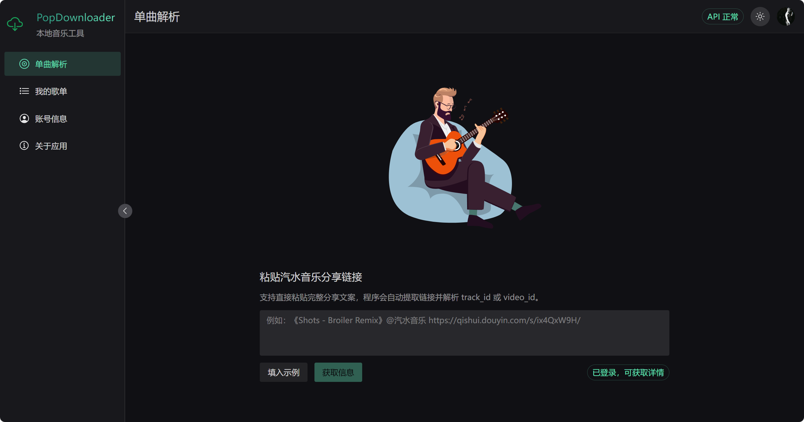
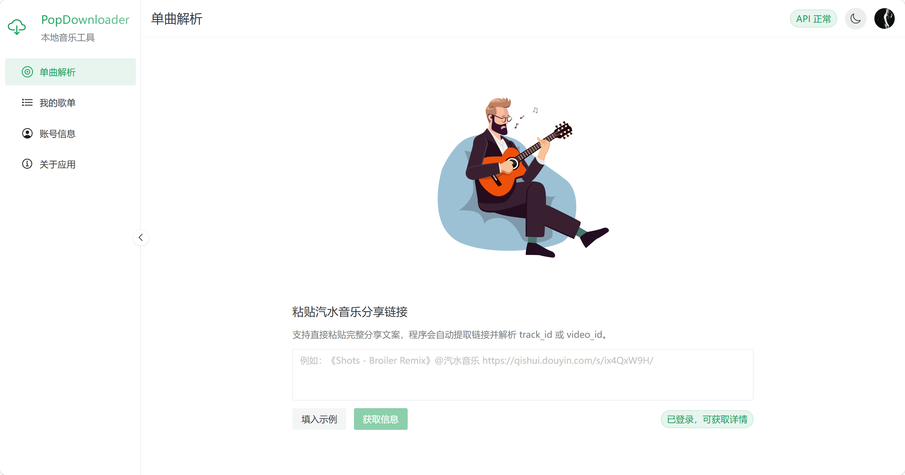
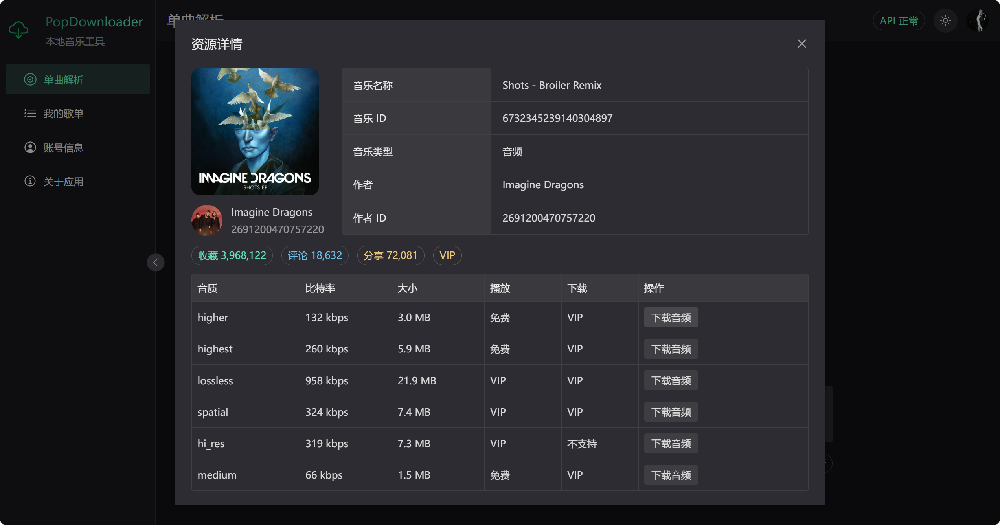
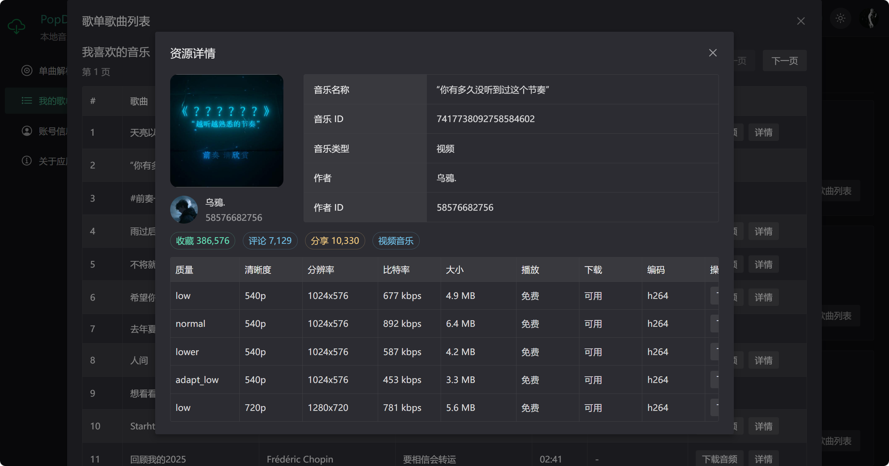
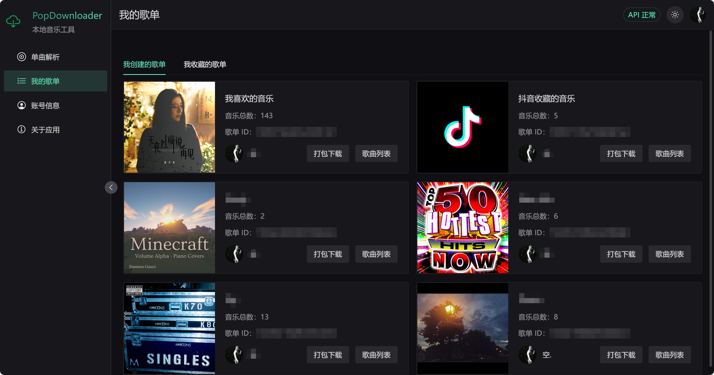
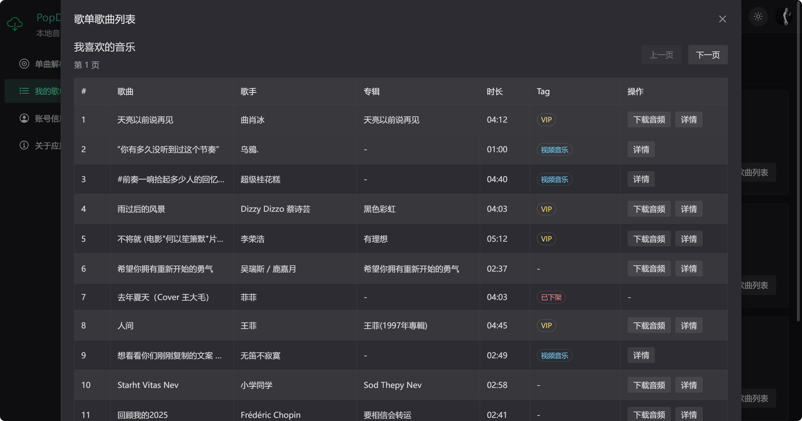
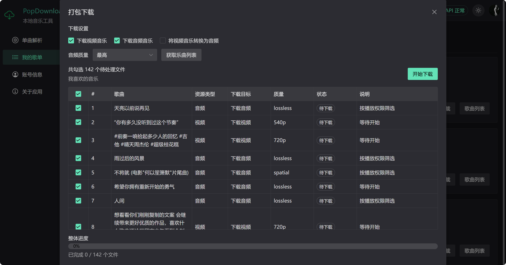
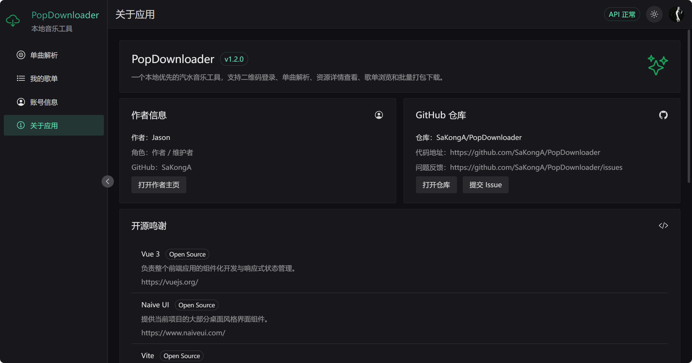

# PopDownloader 🎵

一个本地优先的汽水音乐工具，基于 Vue 3、Naive UI、Vite 和 Express 构建。  
它把登录、解析、查看详情、单曲下载、歌单浏览和批量打包下载这些常用能力整合到了一个本地应用里。

## 🖼️ 界面预览

### 单曲解析



### 单曲解析（浅色）



### 资源详情 - 音乐



### 视频详情



### 我的歌单



### 歌曲列表



### 打包下载



### 关于应用



## 🚀 当前功能

### 1. 二维码登录

- 支持获取登录二维码
- 支持轮询扫码状态
- 支持确认登录后获取 `sessionid`
- 支持登录后自动拉取当前账号信息
- 支持退出登录并清空本地登录状态
- 支持一键登录检测
- 支持文件登录（上传 Cookies 文件）
- 支持二维码登录、文件登录、参数登录多种方式切换

### 2. 单曲解析

- 支持直接粘贴汽水音乐分享文案
- 支持从分享文案中自动提取链接
- 支持请求分享页 HTML 并解析 `track_id` / `video_id`
- 支持单曲详情弹窗展示
- 支持区分音频资源和视频资源
- 支持展示对应资源的可用质量信息

### 3. 音频资源详情

- 支持展示歌曲名称、歌曲 ID、作者信息
- 支持展示收藏数、评论数、分享数
- 支持展示音质、比特率、大小、播放权限、下载权限
- 支持根据账号权限判断可不可下载
- 支持下载音频加密文件
- 支持写入 FLAC 元数据与封面

### 4. 视频资源详情

- 支持展示视频资源基础信息
- 支持展示质量、清晰度、分辨率、比特率、大小、编码
- 支持下载视频文件
- 支持提取视频中的音频并下载

### 5. 我的歌单

- 支持查看“我创建的歌单”
- 支持查看“我收藏的歌单”
- 支持展示歌单封面、标题、曲目数量、拥有者信息

### 6. 歌单详情

- 支持查看歌单内的资源列表
- 支持从歌单中查看音频 / 视频资源详情
- 支持复用统一的资源详情弹窗

### 7. 批量打包下载 📦

- 支持对歌单资源生成批量下载任务
- 支持勾选要处理的任务
- 支持下载音频音乐
- 支持下载视频音乐
- 支持将视频音乐转换为音频
- 支持按偏好选择音频质量（最高 / 最低）
- 支持把多个文件打包成 ZIP 下载
- 支持按“已完成文件数”显示实时整体进度
- 支持在任务表里展示每个任务的状态与说明

### 8. 账号信息页

- 支持展示当前登录账号信息
- 支持显示昵称、ID、头像、会员状态等内容

### 9. 界面与交互

- 支持浅色 / 深色主题切换
- 支持侧边栏页面导航
- 支持首页动画展示
- 支持桌面风格的管理型界面布局

## 🧱 技术栈

- Vue 3
- Naive UI
- Vite
- Express
- Archiver
- fluent-ffmpeg
- ffmpeg-installer
- flac-tagger
- lottie-web
- @vicons/ionicons5

## 🛠️ 运行环境

- Node.js 18 及以上
- npm 9 及以上
- 操作系统：Windows / macOS

> macOS 与 Windows 都可以使用一键登录，两者只是汽水音乐客户端的 Cookies 存放位置不同，程序会自动识别。

## 📥 安装依赖

```bash
npm install
```

## 💻 开发运行

同时启动前端和本地服务：

```bash
npm run dev
```

默认会启动：

- Vite 前端开发服务
- Express 本地接口服务

## 🏗️ 生产构建

```bash
npm run build
```

## ▶️ 本地启动

构建完成后可直接运行：

```bash
npm run start
```

默认监听 `3001` 端口，可用环境变量 `PORT` 覆盖。

## 🎧 转 MP3

项目内置 ffmpeg（`@ffmpeg-installer`），不需要在系统里另外安装。有两个入口：

**1. 界面按钮**

单曲详情页的下载列有两个按钮：

- **下载原始**：保留上游下发的原始容器（`.flac` / `.m4a`）
- **转 MP3**：下载完成后在本地转成 320kbps MP3，并写入 ID3 标签（标题/歌手/专辑/封面）

视频资源则在视频质量列里用「下载音频」，从视频中提取音轨转成 MP3（这条是上游原有逻辑）。

**2. 命令行批量转换**

针对本地已有的音频文件（如 `.m4a` / `.aac` / `.flac`，或扩展名不规范但实际是标准音频容器的 `.bin`），可以批量转成 MP3：

```bash
npm run mp3 -- --out ./mp3-output --kbps 192 <文件或目录> [更多文件或目录...]
```

- `--out`：输出目录，默认 `./mp3-output`
- `--kbps`：目标码率，默认 `192`；源本身是 128k AAC 时 192k 已足够，调到 320k 只增大体积、不提升音质
- 支持传入目录并递归处理，转换前会先探测容器，无法解码的文件直接跳过
- 转换失败会自动清理残缺产物，不会留下 0 字节的 .mp3

> 以上都只做「容器 + 编码」转换，不涉及任何解密或签名，源必须本身是可正常解码的音频。

## 📁 项目结构

```text
PopMusic/
├─ README-assets/           README 截图
├─ src/                     前端页面、组件与 API 封装
│  ├─ pages/                页面
│  ├─ components/           组件
│  ├─ api/                  前端接口请求
│  ├─ assets/               前端静态资源
│  └─ utils/                前端工具函数
├─ server/                  本地 Express API 与下载逻辑
│  ├─ apis/                 接口定义
│  ├─ config/               配置
│  └─ utils/                下载、解析、解密等工具
├─ tools/                   独立命令行工具（如本地音频转 MP3）
├─ index.html               前端入口 HTML
├─ vite.config.mjs          Vite 配置
└─ package.json             项目依赖与脚本
```

## 🔐 关于登录

- 当前项目通过二维码登录流程获取登录态，暂时不太稳定，可以使用aid参数登录
- 登录状态依赖本地保存的 `sessionid`，不会上传云端
- 一键登录依赖汽水音乐桌面客户端的本地 Cookies，Windows 与 macOS 均可用
- 使用一键登录或文件登录前，需要保证汽水音乐客户端已经登录，并且已经完全退出
- 文件登录可通过上传 `Cookies` 文件读取本地登录态
- 应用启动时会自动复用本机客户端的登录态，无需手动点击；主动退出登录后不再自动登录

### 一键登录的 Cookies 位置

| 系统 | 路径 |
| --- | --- |
| Windows | `%AppData%\SodaMusic\Network\Cookies` |
| macOS | `~/Library/Containers/com.soda.music/Data/Library/Application Support/SodaMusic/Cookies` |

macOS 上该目录位于沙盒容器内，在「访达」里按 `Cmd+Shift+G` 粘贴上面的路径即可跳转。
程序读取时会先用系统自带的 `sqlite3` 命令只读打开；如果客户端正占用数据库，会自动复制一份副本再读，不会影响正常使用。

## ❓ 已知限制与常见问题

**接口返回 200 但内容是空的**

汽水音乐对内容类接口（`track_v2` / `video_v2`）做了客户端签名校验，未通过时上游返回 `200` + 空响应体。此时：

- 登录态本身是有效的，账号信息、歌单列表都能正常读取
- 界面会提示「内容接口返回空响应」，而不是笼统的 500 错误
- 这不是登录失败，重新扫码也不会变好

**设备号（iid）**

程序不会使用任何写死的设备号。首次运行时会在 `~/.popdownloader/device-id` 生成一个本机专属的随机设备号并持久化，各台机器互不相同。如需临时指定，可设置环境变量：

```bash
QISHUI_IID=12345678901234 npm run start
```

**批量打包下载想中途停止**

打包面板右上角有关闭按钮，下载过程中点击即可取消；后端检测到客户端断开后会停止继续抓取剩余曲目，不会在后台空转。

## 🙏 特别感谢

本项目在解密与相关实现思路上，参考了以下开源项目，特此感谢：

- SodaDownloader  
  https://github.com/baizeyv/SodaDownloader
- music-lib  
  https://github.com/guohuiyuan/music-lib
- qishui-decrypt  
  https://github.com/naiyQAQ/qishui-decrypt

## ⛔️ 免责声明

- PopDownloader 仅作为学习交流使用，不涉及任何破解、绕过会员限制获取音频的功能，如有侵权，请联系作者删除！
